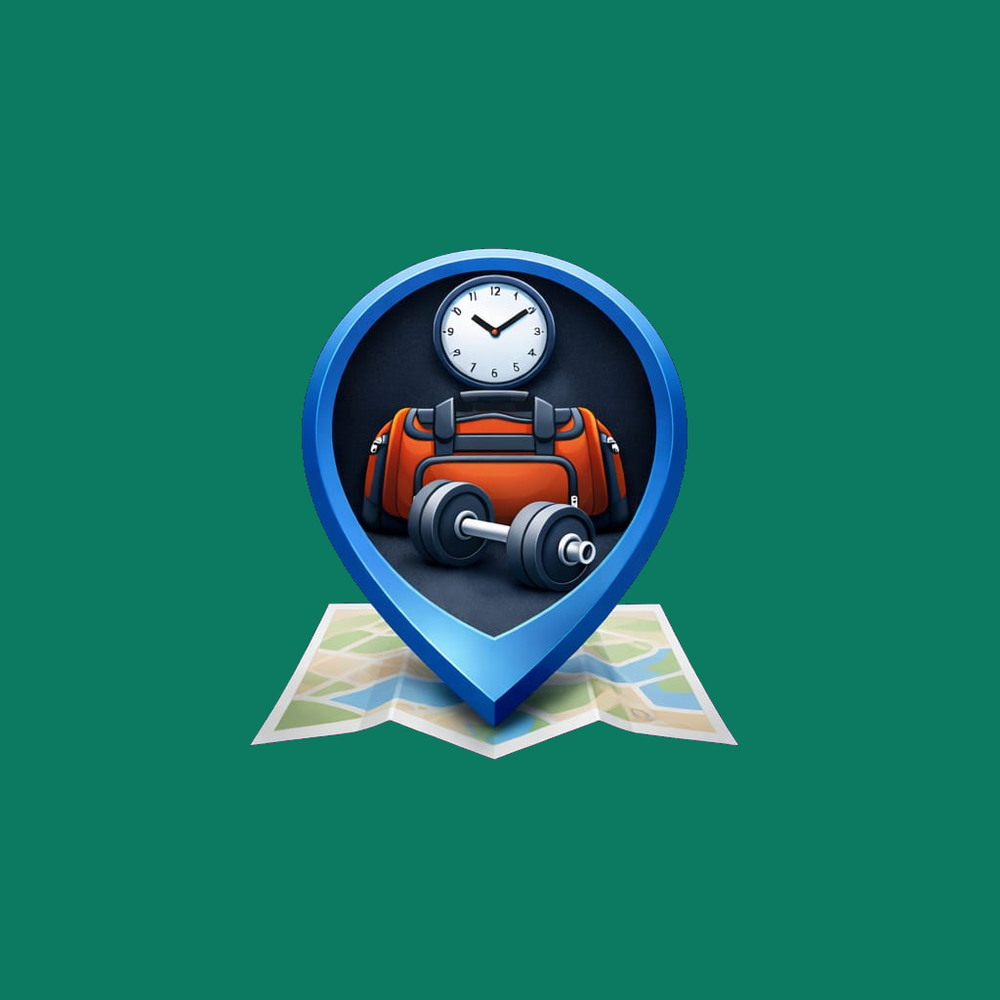

<div align="center">



# GymMap

**Encontre academias perto de você e saiba quão cheias elas estão — antes de sair de casa.**

[](https://flutter.dev)
[](#)
[](https://www.openstreetmap.org)

[Funcionalidades](#-funcionalidades) ·
[Planos](#-planos) ·
[Como rodar](#-como-rodar) ·
[Documentação técnica](docs/BACKEND.md)

</div>

---

## ✨ Funcionalidades

| | |
|---|---|
| 🗺️ **Mapa de academias** | Academias carregadas automaticamente conforme você move o mapa (dados do OpenStreetMap), com busca por nome ou endereço. |
| 👥 **Lotação colaborativa** | Os próprios usuários informam a lotação e todos veem o nível em tempo real: baixa, moderada, alta ou muito alta. |
| 🕒 **Aberta ou fechada** | Indicador de academia fechada; a lotação é ocultada fora do horário de funcionamento. |
| 📈 **Histórico e horários de pico** | Série das últimas 24h e os horários mais movimentados de cada dia. |
| ⚖️ **Comparativo** | Compare a lotação entre academias próximas para escolher a melhor opção. |
| 🔮 **Previsão e alertas** | Previsão de lotação para as próximas horas e alertas personalizados. |
| ⭐ **Favoritos** | Salve suas academias e acompanhe-as rapidamente. |
| 💬 **Comunidade** | Feed com os relatos de lotação dos usuários, que podem confirmar ou contestar cada relato. |
| 👤 **Perfil e conta** | Comece sem cadastro (conta anônima no aparelho) e crie usuário e senha quando quiser, sem perder seus dados. |

## 💎 Planos

| Recurso | Grátis | Essencial | Pro | Elite |
|---|:---:|:---:|:---:|:---:|
| Lotação atual | ✅ | ✅ | ✅ | ✅ |
| Histórico das últimas 24h | | ✅ | ✅ | ✅ |
| Horários de pico por dia | | | ✅ | ✅ |
| Comparativo entre academias | | | ✅ | ✅ |
| Previsão para as próximas horas | | | | ✅ |
| Alertas personalizados | | | | ✅ |
| Cobertura em qualquer lugar do país | | | | ✅ |


Pagamento pelo Google Play ou Pix.

## 🚀 Como rodar

**Pré-requisitos:** [Flutter](https://docs.flutter.dev/get-started/install) (Dart 3.7+) e um emulador ou aparelho Android/iOS.

```bash
git clone https://github.com/frahncky/GymMap.git
cd GymMap
flutter pub get
flutter run
```

O app funciona sozinho em modo local. Para usar contas, assinaturas e lotação compartilhada, suba o backend e aponte o app para ele:

```bash
cd backend && dart pub get && cd ..
dart run backend/server.dart        # sobe em http://localhost:8080

flutter run --dart-define PLAN_BACKEND_BASE_URL=http://10.0.2.2:8080
```

Configurações avançadas, deploy em produção e detalhes da API estão em **[docs/BACKEND.md](docs/BACKEND.md)**.

---

<div align="center">
Feito com 💪 e Flutter · Dados de mapa © colaboradores do <a href="https://www.openstreetmap.org/copyright">OpenStreetMap</a>
</div>
