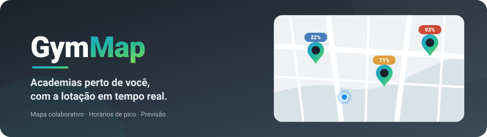

<div align="center">



<br><br>


# GymMap

**Encontre academias perto de você e saiba quão cheias elas estão — antes de sair de casa.**

[](https://github.com/frahncky/GymMap/actions/workflows/ci.yml)
[](https://flutter.dev)
[](https://dart.dev)
[](#-como-executar)
[](https://www.openstreetmap.org)

[Sobre](#-sobre) ·
[Funcionalidades](#-funcionalidades) ·
[Lotação](#-como-funciona-a-lotação) ·
[Pontos](#-pontos-da-comunidade) ·
[Planos](#-planos) ·
[Como executar](#-como-executar) ·
[Arquitetura](#-arquitetura)

</div>

---

## ✨ Sobre

O **GymMap** mostra no mapa as academias ao seu redor e quão cheias elas estão agora. A lotação é **colaborativa**: quem está na academia informa, a comunidade confirma ou contesta, e todo mundo vê o resultado em tempo real.

O app funciona **sem cadastro**: você começa com uma conta anônima no aparelho e cria usuário e senha quando quiser, sem perder favoritos nem histórico. O app está disponível em **português** e **inglês**.

## 🧭 Funcionalidades

<table>
  <tr>
    <td align="center" width="33%"><br><b>Mapa de academias</b><br><sub>Carregadas conforme você move o mapa, com busca por nome ou endereço</sub></td>
    <td align="center" width="33%"><br><b>Lotação colaborativa</b><br><sub>Relatos dos usuários com consenso e tolerância entre votos</sub></td>
    <td align="center" width="33%"><br><b>Aberta ou fechada</b><br><sub>Indicador de horário; a lotação some quando a academia está fechada</sub></td>
  </tr>
  <tr>
    <td align="center"><br><b>Histórico de 24h</b><br><sub>Como a lotação variou ao longo do dia</sub></td>
    <td align="center"><br><b>Horários de pico</b><br><sub>Os momentos mais movimentados de cada dia</sub></td>
    <td align="center"><br><b>Comparativo</b><br><sub>Lotação lado a lado entre academias próximas</sub></td>
  </tr>
  <tr>
    <td align="center"><br><b>Previsão e alertas</b><br><sub>Lotação esperada nas próximas horas e avisos personalizados</sub></td>
    <td align="center"><br><b>Favoritos</b><br><sub>Suas academias sempre à mão</sub></td>
    <td align="center"><br><b>Comunidade</b><br><sub>Feed de relatos para confirmar ou contestar</sub></td>
  </tr>
</table>

**E mais:**

- 🗺️ **Rotas até a academia** a pé, de bicicleta ou de carro, desenhadas no próprio mapa e recalculadas se você sair do caminho.
- 🏷️ **Comodidades** (aulas, cardio, piscina e outras) como ícones abaixo do nome, marcadas e confirmadas pela comunidade; os filtros do mapa usam essas informações.
- ➕ **Sugerir academia** que ainda não aparece no mapa; ela vira um pino provisório até a comunidade confirmar.
- 🕒 **Horário real de funcionamento** vindo do OpenStreetMap; academias fechadas aparecem com pino cinza e um relógio.

## 📊 Como funciona a lotação

Cada relato informa um percentual de ocupação. O app combina os relatos recentes, descarta os que destoam do consenso e mostra o nível no próprio pino do mapa:

| Nível | Faixa | No mapa |
| --- | --- | :---: |
| **Baixa** | até 35% |  |
| **Moderada** | 36% a 65% |  |
| **Alta** | 66% a 85% |  |
| **Muito alta** | acima de 85% |  |

Regras que mantêm o dado honesto:

- **Só quem está lá informa.** Enviar um relato e confirmar ou contestar o de outra pessoa exige estar na academia (até 200 m); o servidor confere a distância.
- **Nada de dado velho.** Só contam relatos das últimas 2 horas; sem eles, a academia mostra *Sem dados*. Com o mapa aberto, a lotação é atualizada a cada 5 minutos.
- **Nada inventado.** Histórico, picos, comparativo e previsão usam apenas relatos reais.

## 🏆 Pontos da comunidade

| Ação | Pontos |
| --- | :---: |
| Enviar um relato de lotação | +1 |
| Relato confirmado pela comunidade | +5 |
| Relato contestado pela comunidade | −2 |
| Academia sugerida e confirmada | +5 |
| Voto em sugestão ou comodidade que a comunidade confirma | +2 |

Os pontos alimentam o ranking semanal da região e podem ser trocados por dias do plano Essencial (**100 pontos = 7 dias**).

## 💎 Planos

| Recurso | Grátis | Essencial | Pro | Elite |
| --- | :---: | :---: | :---: | :---: |
| Lotação atual | ✅ | ✅ | ✅ | ✅ |
| Histórico das últimas 24h | | ✅ | ✅ | ✅ |
| Horários de pico por dia | | | ✅ | ✅ |
| Comparativo entre academias | | | ✅ | ✅ |
| Previsão para as próximas horas | | | | ✅ |
| Alertas personalizados | | | | ✅ |
| Cobertura em qualquer lugar do país | | | | ✅ |

<sub>Nos planos sem cobertura nacional, o mapa mostra academias em até 50 km da sua localização. Pagamento pelo Google Play ou Pix.</sub>

## 🔒 Privacidade

- A localização é usada **só com o app na tela**: não há serviço em segundo plano.
- A conta pode ser apagada pelo próprio app ou pela página pública de exclusão, junto com relatos, votos, sugestões e pontos.

## 🚀 Como executar

**Pré-requisitos:** [Flutter](https://docs.flutter.dev/get-started/install) (Dart 3.7+) e um emulador ou aparelho Android/iOS.

```bash
git clone https://github.com/frahncky/GymMap.git
cd GymMap
flutter pub get
flutter run
```

O app funciona sozinho em modo local. Para usar contas, assinaturas e lotação compartilhada, suba o backend e aponte o app para ele:

```bash
cd backend && dart pub get && cd ..
dart run backend/server.dart        # sobe em http://localhost:8080

flutter run --dart-define PLAN_BACKEND_BASE_URL=http://10.0.2.2:8080
```

<details>
<summary><b>Serviços de mapa configuráveis</b></summary>

<br>

| `--dart-define` | Padrão | Uso |
| --- | --- | --- |
| `MAPLIBRE_STYLE_URL` | OpenFreeMap *liberty* | Estilo vetorial (MapLibre Style JSON) do mapa base |
| `MAP_TILE_ATTRIBUTION` | `OpenStreetMap contributors` | Créditos exibidos no mapa (separados por `\|`) |
| `OVERPASS_API_URL` | `overpass-api.de` | Busca de academias; espelhos públicos e o Nominatim entram como reserva |
| `NOMINATIM_BASE_URL` | `nominatim.openstreetmap.org` | Busca de endereços e reserva da busca de academias |
| `OSRM_BASE_URL` | `routing.openstreetmap.de/routed-{profile}` | Trajetos até a academia (a pé, bicicleta e carro); `{profile}` vira `foot`, `bike` ou `car` |

Os servidores públicos do OpenStreetMap servem para desenvolvimento; em produção, use instâncias próprias ou um provedor pago.

</details>

<details>
<summary><b>Testes e análise</b></summary>

<br>

```bash
flutter analyze
flutter test
```

</details>

Em produção, a API roda no **Cloud Run** atrás do **Firebase Hosting**, com estado no Firestore. Mais detalhes:

- **[docs/BACKEND.md](docs/BACKEND.md)**: API, deploy e assinatura do app para a Play Store
- **[docs/FIREBASE_SETUP.md](docs/FIREBASE_SETUP.md)**: projeto Firebase, Hosting e Firestore
- **[docs/CLOSED_TEST_SETUP.md](docs/CLOSED_TEST_SETUP.md)**: teste fechado no Google Play
- **[docs/LINGUAGEM.md](docs/LINGUAGEM.md)**: guia de linguagem dos textos do app

## 🧱 Arquitetura

| Pasta | Conteúdo |
| --- | --- |
| `lib/features/gym_map/domain` | Modelos de academia, lotação, horários de funcionamento, planos e insights |
| `lib/features/gym_map/data` | Lotação colaborativa, assinaturas, rotas, cache de academias e serviços de mapa |
| `lib/features/gym_map/presentation` | Tela do mapa, painéis, comunidade, sugestões, comodidades e controles |
| `lib/core` | Tema da marca, traduções, widgets compartilhados e métricas do app |
| `lib/l10n` | Textos do app em português e inglês |
| `backend/` | Servidor Dart de contas, assinaturas, relatos, pontos, sugestões e comodidades |
| `tool/brand` | Gerador do ícone e das imagens da loja |

**Tecnologias:** Flutter · Dart · flutter_map + vector_map_tiles · OpenStreetMap (Overpass / Nominatim / OSRM) · Geolocator · In-App Purchase · Google Mobile Ads · Cloud Run · Firebase Hosting · Firestore

---

<div align="center">
<sub>Feito com 💪 e Flutter · Dados de mapa © colaboradores do <a href="https://www.openstreetmap.org/copyright">OpenStreetMap</a></sub>
</div>
